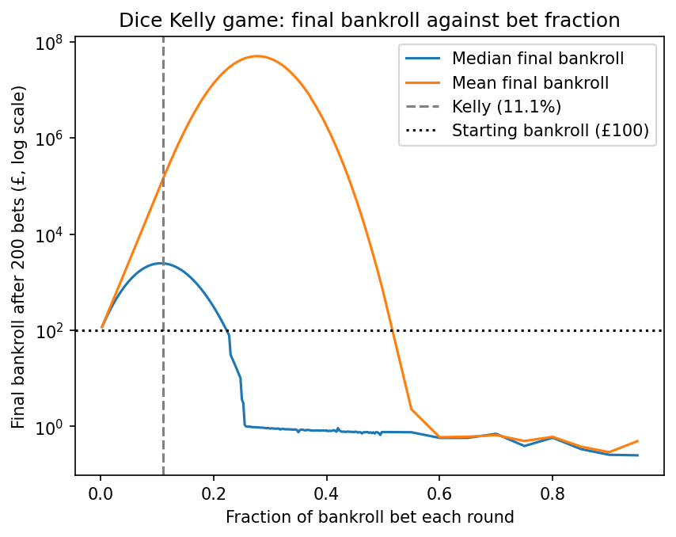

# Kelly Criterion: Dice Betting Simulation

## What it does
The game is a dice roll, you stake a fixed fraction of your bankroll (which starts at £100). The game pays 3:1 when you win and a loss costs your stake.

The probability of winning is 1/3 (win if roll = 5 or 6), the game will stop if you have a bankroll below £1.

The program simulates 10,000 runs of 200 bets and shows the median, mean and ruin percentage (percentage of times the game stopped) for each fixed fraction of your bankroll i.e. your stake.

## The Kelly fraction
I used the Kelly fraction which maximises the log growth rate of my wealth which in this case is 1/9.

$$
f^* = \frac{bp - q}{b}, \qquad b = 3,\ p = \frac{1}{3},\ q = \frac{2}{3}
$$

$$
f^* = \frac{3 \times \frac{1}{3} - \frac{2}{3}}{3} = \frac{1}{9} \approx 0.111
$$

## Results
Seed 1, 10,000 simulations x 200 bets, starting bankroll £100

| Strategy | Fraction | Median | Mean | Ruined |
|---|---|---|---|---|
| Half Kelly | 5.6% | £1,527 | £3,904 | 0.0% |
| Kelly | 11.1% | £3,695 | £159,689 | 0.3% |
| 2x Kelly | 22.2% | £104 | £13,752,874 | 31.1% |
| 4x Kelly | 44.4% | £1 | £10,420 | 98.9% |

## Final bankroll against bet fraction

The median peaks at around 11% as this is at Kelly (11.1%) which is the optimum fraction and therefore has the highest "typical" return. The median crosses £100 at 2x Kelly (22.2%), after this point the typical bettor loses money even though every bet has a positive edge. The mean peaks further to the right as the game is skewed because betting higher fractions of your bankroll results in some exceptionally lucky games which brings the mean higher before it falls dramatically and is a poor guide to what a typical bettor experiences. Both curves are smooth as the fractions use the same dice, so each game, k, will have the same dice at each fraction. This means the only changing variable is the fraction so we can compare.

The chart uses 2,000 simulations per fraction so values differ slightly from the table.

## What I learned
The mean and median disagree a lot, this is clearest at 2x Kelly (22.2%). This occurs due to compounding, on successful runs you will make far more and this brings the average a lot higher, however most runs end lower causing the distribution to be heavily right skewed. The median is a better estimate of the typical payoff of this game as it is the middle value and we can see Kelly gives the highest median of the 4 fractions. 

Looking at 4x Kelly (44.4%), each loss wipes out 44% of our bankroll with losses occurring 2/3 of the time, therefore a short losing streak takes you below £1. Over-betting can ruin you even with a positive edge. Half Kelly is more popular in practice as although you give up some growth (£1,527 vs £3,695) you have far less volatility. This is an insight for real markets as you don't know your exact edge, so if you overestimate it and go past full Kelly, growth falls fast. Therefore half Kelly is the safety margin.

## How to run
Install the dependency (from repository root):

    py -m pip install -r requirements.txt

Run the simulation:

    py "Dice Kelly/dice_kelly.py"

Then draw the chart:

    py "Dice Kelly/chart.py"